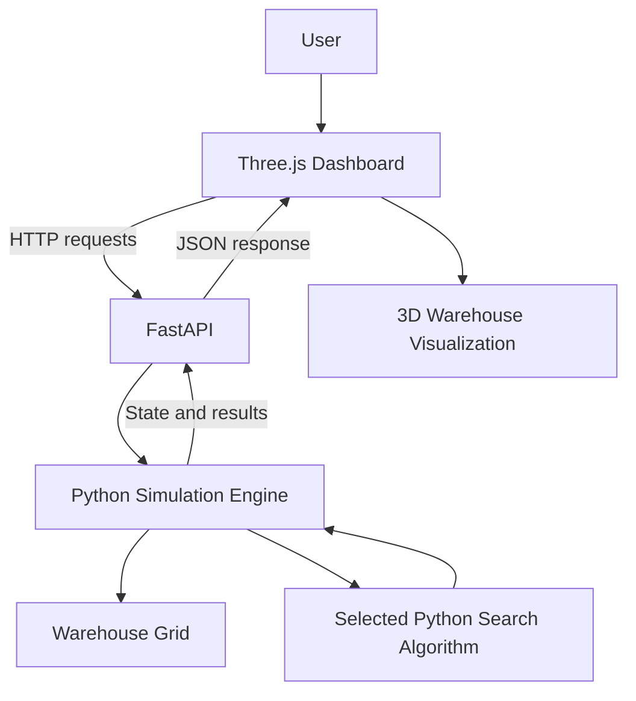

# NavBot 3D — Python AI Warehouse Simulator

A 3D warehouse simulator developed for **Fundamentals of AI (CF321) – Search Algorithms**. Multiple autonomous robots receive pickup-and-delivery tasks, plan routes around obstacles, and coordinate their movement.

**Python is the single source of truth for search and simulation decisions.** The browser interface is built with Three.js and communicates with the Python engine through FastAPI.

---

## Table of Contents

- [Project Overview](#project-overview)
- [AI Problem Formulation](#ai-problem-formulation)
- [Search Algorithms](#search-algorithms)
- [Features](#features)
- [System Architecture](#system-architecture)
- [Technology Stack](#technology-stack)
- [Project Structure](#project-structure)
- [Getting Started](#getting-started)
- [Running Tests](#running-tests)
- [API Overview](#api-overview)
- [Evaluation Metrics](#evaluation-metrics)
- [Limitations](#limitations)
- [Team](#team)

## Project Overview

NavBot 3D demonstrates how search algorithms can be applied to warehouse navigation.

A user creates a task by selecting a pickup zone, a delivery zone, and a priority. The simulation assigns the task to an available robot. The robot navigates to the pickup location, collects the package, and then plans a route to the delivery location.

The warehouse is displayed as an interactive 3D environment. Internally, navigation is calculated on a 2D grid, where each cell represents a possible robot position.

**Main objective:** implement and compare four search algorithms on the same warehouse pathfinding problem, and demonstrate how their paths can be used in a multi-robot delivery simulation.

## AI Problem Formulation

| Element | Definition in NavBot 3D |
|---|---|
| Agent | An autonomous warehouse robot |
| Environment | A warehouse represented as a 2D grid |
| State | The robot's current grid cell, represented by coordinates `(x, z)` |
| Initial state | The robot's current position when a search starts |
| Goal state | The current target cell: a pickup zone, delivery zone, or charging station |
| Actions | Move one cell up, down, left, or right |
| Transition rule | A move is valid if the destination is inside the map and is not blocked or reserved |
| Obstacles | Warehouse racks, user-placed obstacles, and dynamic obstacles such as the moving forklift |
| Step cost | 1 for each valid move |
| Objective | Find a valid path from the initial state to the goal; optimal algorithms minimize total movement cost |

A delivery task has two navigation stages:

1. **Pickup:** navigate from the robot's current position to the selected pickup zone.
2. **Delivery:** after collecting the package, navigate to the selected delivery zone.

The search algorithms solve the current navigation leg. The simulation engine manages task stages and robot movement.

## Search Algorithms

All four algorithms are implemented in **Python**, in separate files under `backend/algorithms/`.

| Algorithm | Search strategy | Main data structure | Optimality |
|---|---|---|---|
| Breadth-First Search (BFS) | Explores the grid level by level | Queue (`deque`, FIFO) | Shortest path when every move has equal cost |
| Depth-First Search (DFS) | Explores one branch deeply before backtracking | Stack (`list`, LIFO) | Does not guarantee a shortest path |
| A* Search | Combines the cost so far with an estimate to the goal | Priority queue (`heapq`) | Optimal with the heuristic and unit-cost movement used here |
| Greedy Best-First Search | Prioritizes the node estimated to be closest to the goal | Priority queue (`heapq`) | Does not guarantee a shortest path |

### Heuristic Function

A* and Greedy Best-First Search use **Manhattan Distance**:

\[
h(n) = |x_n - x_g| + |z_n - z_g|
\]

Manhattan Distance is suitable because the robot moves in four directions and diagonal movement is not allowed.

### A* Evaluation Function

A* evaluates a node using:

\[
f(n) = g(n) + h(n)
\]

- **g(n):** movement cost from the initial state to the current node.
- **h(n):** estimated remaining cost from the current node to the goal.
- **f(n):** estimated total path cost through the current node.

Greedy Best-First Search uses only `h(n)`, while A* considers both `g(n)` and `h(n)`.

### Algorithm Source Files

- BFS: `backend/algorithms/bfs.py`
- DFS: `backend/algorithms/dfs.py`
- A*: `backend/algorithms/astar.py`
- Greedy Best-First: `backend/algorithms/greedy.py`
- Shared search utilities: `backend/algorithms/common.py`
- Algorithm selection and benchmarking: `backend/algorithms/__init__.py`

All algorithms use the same grid representation, four-direction movement rules, and unit movement cost, allowing comparison under the same conditions.

## Features

### Warehouse Simulation

- Interactive 3D warehouse environment.
- Three autonomous robots with individual positions, states, routes, and battery levels.
- Pickup-and-delivery tasks with **Normal**, **High**, and **Urgent** priorities.
- Pickup zones, delivery zones, racks, and charging stations.

### AI Pathfinding and Comparison

- Select BFS, DFS, A*, or Greedy Best-First Search from the dashboard.
- Visualize the latest search route and explored cells.
- Compare the four algorithms for the same start and goal.
- Review path length, solution cost, explored nodes, and search time.

### Dynamic Environment and Robot Coordination

- Add or remove obstacles interactively.
- Enable a moving forklift as a dynamic obstacle.
- Re-plan routes when relevant obstacles change.
- Traffic-yield / pull-over behavior for supported head-on situations when a suitable side space is available.
- Battery consumption during movement and gradual charging at charging stations.

### Dashboard and Simulation Tools

- Live robot and task status.
- Battery telemetry, minimap, and event log.
- Simulation speed controls.
- Scenario lab: normal operations, rush hour, emergency orders, blocked aisle, and low-battery fleet.
- Movement history replay.
- Traffic heatmap.
- CSV task report export.
- Focus mode.

**Architecture note:** JavaScript does not implement a second pathfinding engine. It sends user commands to Python and renders the state returned by the backend.

## System Architecture

The application is split into a browser-based frontend and a Python backend.



### Backend

Python is responsible for:

- The four search algorithm implementations.
- Warehouse grid and obstacle representation.
- Task assignment and priority handling.
- Robot movement, battery, charging, and traffic coordination.
- Benchmark results and simulation state.
- The REST API used by the frontend.

### Frontend

The frontend is responsible for:

- Rendering the warehouse, robots, racks, and visual objects with Three.js.
- Displaying the dashboard, controls, minimap, and telemetry.
- Sending commands to the backend.
- Rendering routes and simulation state returned by Python.

## Technology Stack

| Technology | Purpose |
|---|---|
| Python | Search algorithms and simulation logic |
| FastAPI | HTTP API between frontend and backend |
| Uvicorn | Runs the FastAPI application |
| Three.js | Interactive 3D warehouse visualization |
| JavaScript | Frontend behavior and API communication |
| HTML and CSS | Application layout and styling |
| Vite | Frontend development server and production build |
| Pytest | Backend and algorithm tests |

## Project Structure

```text
NavBot3D/
├── backend/
│   ├── algorithms/
│   │   ├── __init__.py
│   │   ├── common.py
│   │   ├── bfs.py
│   │   ├── dfs.py
│   │   ├── astar.py
│   │   └── greedy.py
│   ├── core/
│   │   ├── __init__.py
│   │   ├── grid.py
│   │   └── simulation.py
│   ├── tests/
│   │   ├── conftest.py
│   │   ├── test_algorithms.py
│   │   ├── test_simulation.py
│   │   └── test_api.py
│   ├── main.py
│   └── requirements.txt
├── frontend/
│   ├── src/
│   │   ├── analytics/
│   │   ├── core/
│   │   ├── ui/
│   │   └── world/
│   ├── index.html
│   ├── package.json
│   └── vite.config.js
├── .gitignore
├── README.md
├── START_WINDOWS.bat
├── START_BACKEND.bat
├── START_FRONTEND.bat
└── RUN_TESTS_WINDOWS.bat
```

## Getting Started

### Requirements

- Windows 10 or 11 (the included batch files use Windows commands).
- Python 3.10 or newer.
- Node.js supported by Vite 7 (Node.js 20.19+ or 22.12+).
- npm.
- A modern browser with WebGL support.
- Internet access for the first installation of Python and npm dependencies.

### Option 1: Start everything on Windows

1. Download or clone the repository.
2. Open the project folder.
3. Double-click `START_WINDOWS.bat`.
4. Keep both terminal windows open.
5. Open **http://127.0.0.1:5173** in your browser.

The startup script opens the Python backend and frontend in separate terminal windows. It checks/installs their dependencies before starting each service.

### Option 2: Start manually from VS Code Terminal

Open two terminals in the project root.

**Terminal 1 — Python backend**

```powershell
cd backend
py -m pip install -r requirements.txt
py -m uvicorn main:app --host 127.0.0.1 --port 8000
```

The API runs at **http://127.0.0.1:8000**.

**Terminal 2 — Three.js frontend**

```powershell
cd frontend
npm install
npm run dev
```

The frontend runs at **http://127.0.0.1:5173**.

Keep both services running while using the simulator.

### Check the backend

Open **http://127.0.0.1:8000/api/health**. A successful response reports the backend status and available algorithm names.

### Important

The frontend uses Vite's proxy to send `/api` requests to the local FastAPI server. Both frontend and backend must be running. Hosting the repository on GitHub does not itself host the Python API or run the simulator; public access requires deploying the backend and frontend or keeping a suitable tunnel and local services running.

## Running Tests

### Run the Python test suite

From the project root:

```powershell
cd backend
py -m pip install -r requirements.txt
py -m pytest -q
```

Or run `RUN_TESTS_WINDOWS.bat` from the project root after installing Python dependencies.

The tests cover:

- Valid paths and legal four-direction movement for all four algorithms.
- Blocked starts/goals and unreachable goals.
- BFS and A* path-cost agreement on included test cases.
- Benchmark output for all four algorithms.
- Multi-robot task completion using each algorithm.
- Urgent-task interruption rules.
- Robot cell-occupancy checks and traffic-yield behavior.
- Dynamic obstacle replanning and moving-forklift behavior.
- Battery charging, reset behavior, and predefined scenarios.
- FastAPI health, state, command, benchmark, and history endpoints.

### Build the frontend

From the project root:

```powershell
cd frontend
npm install
npm run build
```

The build creates the production frontend bundle in the `dist` folder.

### Recorded Verification Status

The included `TEST_RESULTS.txt` records **43 passing Python tests**, successful FastAPI TestClient checks, and successful JavaScript syntax checks in the preparation environment.

That record also notes that npm dependency installation, the Vite production build, and full browser-based 3D visual inspection were not completed in that environment. Run the frontend build and open the simulator on the target computer before treating those checks as complete.

## API Overview

The FastAPI service runs on port `8000`.

| Method | Endpoint | Purpose |
|---|---|---|
| GET | `/api/health` | Check backend availability and list supported algorithms |
| GET | `/api/state` | Get the current simulation state |
| GET | `/api/history` | Get recorded simulation history |
| POST | `/api/command` | Send simulation, task, algorithm, obstacle, or scenario commands |
| POST | `/api/benchmark` | Compare the four algorithms between two named zones |

Example: start the demonstration tasks:

```json
{
  "action": "demo"
}
```

Example: select A*:

```json
{
  "action": "algorithm",
  "algorithm": "astar"
}
```

Example: create a delivery task:

```json
{
  "action": "add-task",
  "pickup": "Pickup A",
  "delivery": "Delivery A",
  "priority": "urgent"
}
```

Example: compare algorithms between two zones:

```json
{
  "start": "Pickup A",
  "goal": "Delivery A"
}
```

The benchmark response includes each algorithm's solution status, path, path length/cost, explored nodes, visited order, and search time. The benchmark implementation averages search time over five repetitions by default.

## Evaluation Metrics

- **Solution found:** whether a route was found.
- **Path length / solution cost:** number of moves in the returned path; each move costs 1.
- **Nodes explored:** number of visited search states.
- **Search time:** time spent by the Python search function, reported in milliseconds.

For a fair comparison, use the same start zone, goal zone, warehouse map, and obstacle configuration for all four algorithms. Search time varies with hardware and should be interpreted as an experimental measurement, not a fixed property of an algorithm.

## Limitations

- The 3D warehouse is a visualization; navigation is calculated on a 2D grid.
- The movement model uses four directions and a uniform cost of 1 per move.
- Battery consumption and charging are simplified educational models, not physical robot battery simulations.
- Traffic-yield / pull-over behavior handles supported situations when a suitable side cell is reachable. It is not a complete multi-agent pathfinding or universal deadlock-resolution algorithm.
- Search-time measurements depend on hardware and map configuration.
- The project is a simulator and does not control physical warehouse robots.

## Team

Add the names and student IDs of all team members before submission. The project is designed for a team of 2–4 students.

Suggested contribution areas:

- 3D warehouse environment and dashboard.
- Python search algorithms and heuristic design.
- Grid representation, simulation, and robot coordination.
- Task management, API integration, testing, and documentation.

---

**Course:** Fundamentals of AI (CF321) — Search Algorithms  
**Project:** NavBot 3D — Python AI Warehouse Simulator
